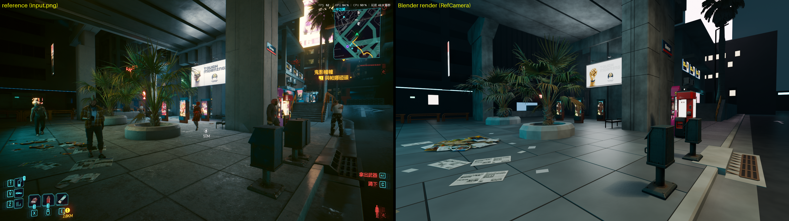

# img2scene

把一張場景圖變成可編輯的 Blender 場景。由 Claude 看圖拆解物件、撰寫 prompt 並審核結果，FLUX.2 klein 生成每個物件的乾淨 2D 圖，TRELLIS.2 轉成 3D 模型，最後由 Claude 透過 Blender MCP 在 Blender 裡直接建出建築、擺放模型、打光。



## 流程

```
場景圖
  │  Claude 看圖 → scene.json（物件、bbox、深度、prompt）
  ▼
參考裁切圖（Real-ESRGAN 放大）
  │  FLUX.2 klein：裁切圖 + prompt → 白底單一物件圖
  │  Claude 逐張審核，有缺點就改寫 prompt 再生成（每個物件至少 4 張）
  ▼
選出最佳的一張 → RMBG-2.0 去背
  │  TRELLIS.2 → 帶貼圖的 GLB
  │  文字招牌改用 2D 圖做成立體浮雕板
  ▼
Blender（由 Claude 透過 Blender MCP 操作，沒有建置腳本）
  │  由消失點反推相機 → 依原圖量尺寸建出建築 → 匯入模型並擺位
  │  程序化材質、散佈物、燈光、霧與光暈
  │  Claude 每一步都看畫面比對原圖再修正
  ▼
scene.blend
```

完整的逐步操作說明在 [AGENT.md](AGENT.md)，那是寫給執行這條管線的 AI agent 看的手冊。

## 需求

- Windows 11 + WSL2 Ubuntu，NVIDIA 顯示卡 12 GB VRAM 以上（在 RTX 3060 上測試）
- WSL 記憶體 24 GB 以上，另加 swap
- [TRELLIS.2](https://github.com/microsoft/TRELLIS.2)，裝在 `~/TRELLIS.2`，conda 環境 `trellis2`
- [ComfyUI](https://github.com/comfyanonymous/ComfyUI)，裝在 `~/ComfyUI`，conda 環境 `comfyui`
- [FLUX.2 klein](https://github.com/black-forest-labs/flux2) 的模型檔，放在 `~/ComfyUI/models/`（檔名與下載位置見 [ComfyUI 官方教學](https://docs.comfy.org/tutorials/flux/flux-2-klein)）
- Blender 5.x，並安裝 MCP for Blender 外掛、在 agent 端接上 Blender MCP；執行步驟 5 之後的流程時 Blender 要開著

路徑若與上述不同，需要修改 `pipeline/` 內的腳本與 `AGENT.md`。

### 不在版本庫內、需要自行準備的檔案

以下兩項不進版控，但執行時必需，放在 `pipeline/` 底下：

```bash
# 在 WSL 內，$P 為專案路徑
mkdir -p $P/pipeline/models $P/pipeline/vendor
wget -P $P/pipeline/models https://github.com/xinntao/Real-ESRGAN/releases/download/v0.1.0/RealESRGAN_x4plus.pth
conda activate trellis2
pip install --no-deps --target $P/pipeline/vendor spandrel     # 裝在專案內，不動 trellis2 環境
```

## 使用方式

建議的用法是讓 Claude Code 之類的 agent 依照 `AGENT.md` 執行，因為寫 `scene.json`、審圖、改 prompt 都需要看圖判斷：

> 依照 AGENT.md，用 `<你的圖檔>` 做出 Blender 場景。

2D 圖與 3D 模型的部分也可以手動分兩段執行（批次模式，同一個 prompt 換種子生成 4 張，不做 prompt 迭代）：

```powershell
.\pipeline\run_all.ps1 generate    # 參考圖 + 候選圖 + 對照表
# 看 work\objects\<id>\sheet.png，寫 work\selection.json
.\pipeline\run_all.ps1 models      # 去背 + TRELLIS
```

`run_all.ps1` 是依手動步驟整理的，尚未完整執行過一次。Blender 場景沒有腳本可跑：模型產生後，請 agent 依 `AGENT.md` 步驟 6 透過 Blender MCP 組裝。

## 輸出

| 檔案 | 內容 |
|---|---|
| `scene.blend` | 完整場景，貼圖已打包；`RefCamera` 對應原圖視角，並掛有原圖當背景方便微調。它是由 agent 直接在 Blender 裡建的，沒有可重跑的建置腳本 |
| `work/renders/view_ref.png` | 原圖視角的渲染 |
| `work/renders/view_overview.png` | 另一個角度的總覽 |
| `work/objects/<id>/` | 每個物件的參考圖、候選圖、prompt 紀錄、去背圖、GLB |

## 效能參考（RTX 3060 12 GB，模型放在 HDD）

| 階段 | 耗時 |
|---|---|
| FLUX.2 klein 9B，1 MP、4 步 | 冷啟動首張約 5 分鐘，之後約 30 秒/張 |
| FLUX.2 klein 4B | 冷啟動首張約 2–4 分鐘，之後約 15 秒/張 |
| TRELLIS.2 | 載入約 5 分鐘，每個物件 2–16 分鐘 |
| Blender 組裝（agent 透過 MCP 逐步建模、比對、調整） | 視場景複雜度，約 30–90 分鐘；單次渲染約 15 秒 |

## 已知限制

- **文字**：TRELLIS.2 會把招牌上的文字重建成亂碼，所以文字招牌改用影像浮雕板；單一字母（例如積木上的 G）仍可能變形。
- **實心方塊**：箱子、積木這類物件在 12 GB VRAM 上要用 TRELLIS 的 512 管線，1024 會出現 CUDA 錯誤。
- **位置精度**：深度是看圖估計的，結果適合當可編輯的初版，不是精確重建。
- **物件會被重新詮釋**：2D 圖是模型依裁切圖和文字描述重新生成的，被遮擋或很糊的部分是模型補出來的，細節可能與原圖不同。
- **場景不可重現**：建築、擺位、材質、燈光是 agent 每次看圖現做的，同一張圖跑兩次結果不會相同；`scene.blend` 是唯一的成果，請自行備份。
- **VRAM**：ComfyUI 與 TRELLIS 不能同時執行。
- **磁碟**：模型合計約 30 GB；WSL 內的 `df` 顯示的是虛擬磁碟上限，請以 Windows 磁碟的實際剩餘空間為準。

## 授權注意

- FLUX.2 klein **9B 為非商用授權**；4B 為 Apache 2.0。要商用請把 `scene.json` 的 `generation.model` 設為 `4b`。
- TRELLIS.2、RMBG-2.0、Real-ESRGAN 各有自己的授權條款，使用前請自行確認。
- 貼圖只從 [Poly Haven](https://polyhaven.com) 下載，全部為 CC0。
- 輸入圖片的著作權由使用者自行負責；範例圖 `test.jpg` 是遊戲畫面截圖，僅作測試用途。
